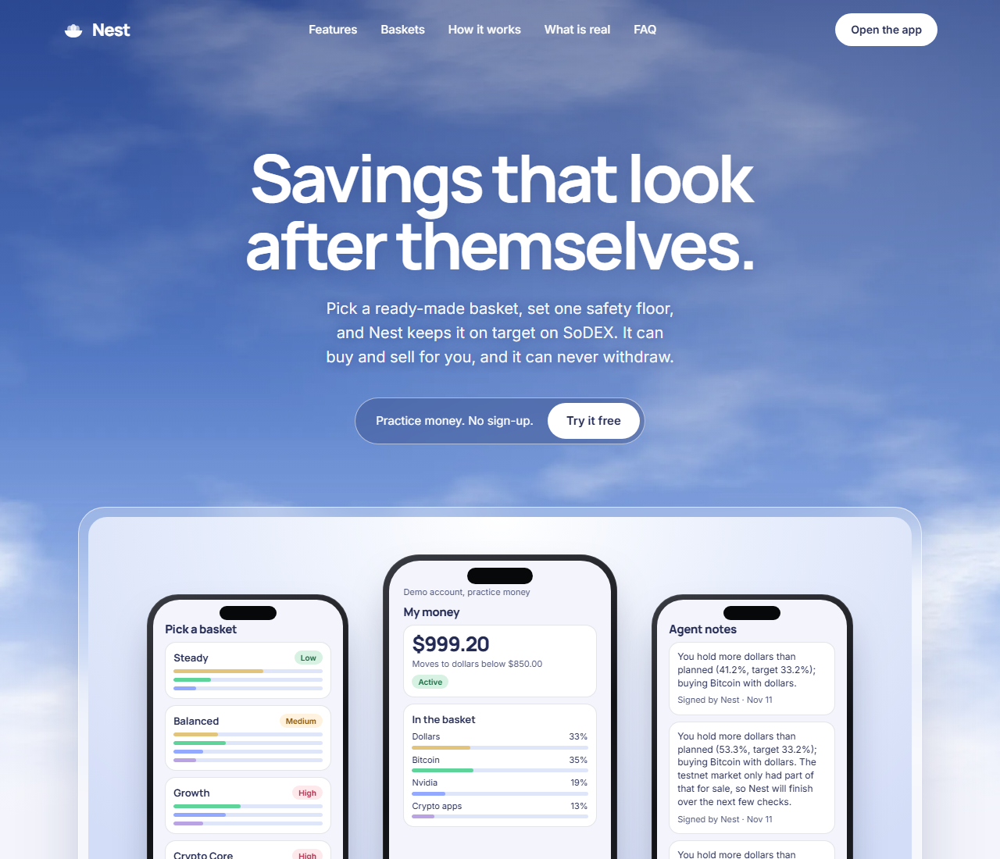
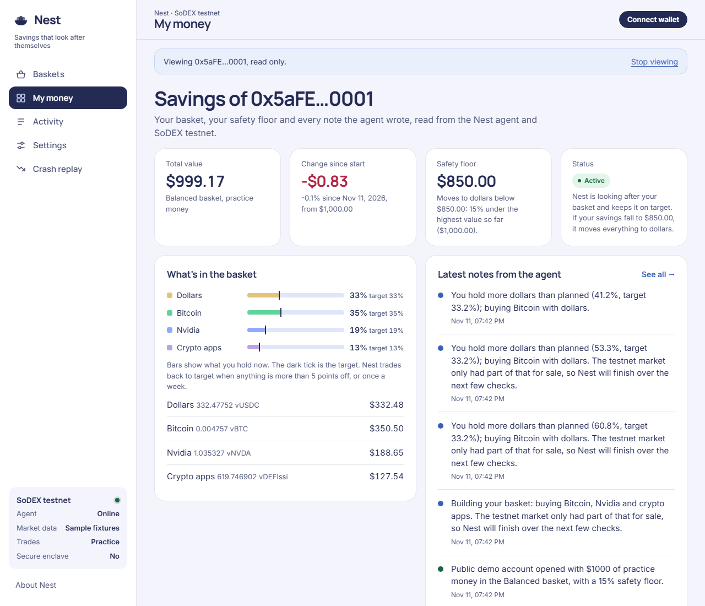

# Nest

**Savings that look after themselves.** Pick one of four ready-made baskets, set one safety floor
("if my savings drop 15%, move everything to dollars"), and Nest keeps the basket on target on
SoDEX. The agent can buy and sell for you, and it can never withdraw.

Built for the SoSoValue Buildathon (Wave 3) on SoSoValue data and SoDEX testnet.



## Who it is for

People who want to put their savings to work and have no idea where to start. They do not want to
pick coins, read charts, or hand a stranger a key that can move their money.

## What it does

| | |
|---|---|
| **Four baskets** | Steady (60% dollars), Balanced, Growth, Crypto Core. Built only from SoDEX testnet markets that have buyers and sellers: Bitcoin, Nvidia, the DEFI.ssi index, and USDC. |
| **SoSoValue signals** | Bitcoin and Ethereum spot ETF net flows (last 5 settled days) and the Crypto Fear & Greed index lean each basket up to 5 points toward or away from an asset. Every lean is one plain sentence with its source. |
| **Safety floor** | Counted from the highest value so far. When it is hit, Nest sells everything to USDC and stops trading until you resume. An optional cash-out date does the same on a set day. |
| **Trade-only key** | Your wallet registers a SoDEX *permissioned API key* with withdraw, transfer and cancel switched off (permissions mask 14). Anyone can check it at `GET /api/v1/user/{address}/api-keys` on the SoDEX gateway. The funds never leave your own SoDEX account. |
| **Signed track record** | Every decision, trade and settings change is a log entry signed by the agent's journal key. The app checks each signature in your browser ("Verified"). |
| **Crash replay** | Runs a made-up crash through the same decision code and shows your basket with and without the floor. |
| **Practice money** | A $1,000 paper account priced and filled against the live SoDEX testnet order books. A public demo account runs all the time. |



## How it works

```
SoSoValue OpenAPI ──► signals ──► target weights ─┐
SoDEX testnet books ──────────────────────────────┼─► decide() ─► hold | rebalance | exit
user's balances + safety floor + high-water mark ─┘          │
                                                             ▼
                        live: orders signed with the user's trade-only key ─► SoDEX testnet
                        paper: filled against the live testnet top of book
                                                             │
                                                             ▼
                                        signed journal entry ─► app (verified in browser)
```

- `agent/` Node 24 + TypeScript (run directly, no build), `viem` is the only dependency, `node:sqlite`, `node:http`.
  - `decide.ts` pure decision logic: valuation at the bid, drift > 5 points or weekly cadence, IOC limit orders rounded to SoDEX tick and step sizes, minimum $5 orders, sells before buys, floor and cash-out exits. An empty book is treated as "no price yet", never as a crash, and a partly filled exit keeps selling at the next check.
  - `sodex/sign.ts` EIP-712 signing for SoDEX key registration (universal domain, `0x02`) and spot `batchNewOrder` (spot domain, `0x01`). Key registration matches the official Python SDK golden vector byte for byte, and the signing pipeline matches all 20 Go SDK vectors.
  - `keys.ts` one API key per user, derived as HMAC(root, address); no private key is stored. The root comes from a Phala dstack enclave when one is present, otherwise from `ROOT_SECRET`. The app shows which.
  - `server.ts` HTTP API (`docs/api.md`). Linking and settings changes require the owner's wallet signature; settings nonces only go up, so a signature cannot be replayed.
- `app/` Vite + React 19 + wagmi/viem. Landing page in the Cairn style, app screens in the Open Bucket style: Baskets, Get started, My money, Activity, Settings, Crash replay. Works at 375px phone width.

### SoSoValue API used

`/etfs/summary-history?symbol=BTC|ETH&country_code=US`, `/analyses/fgi_indicator`, `/news/pick`, cached 10 minutes (20 requests/minute limit). See `docs/research/sosovalue-api.md`.

### SoDEX API used

Testnet gateway `https://testnet-gw.sodex.dev/api/v1`: `/spot/markets/symbols`, `/spot/markets/bookTickers`, `/spot/accounts/{addr}/balances`, `/user/{addr}/subaccounts`, `/user/{addr}/api-keys`, `POST /user/{addr}/api-keys` (permissioned key), `POST /spot/trade/orders/batch`, `/spot/accounts/{addr}/orders/history`. See `docs/research/sodex-testnet.md`.

## Run it

Requires Node 24.

```bash
cd agent && npm install && cp .env.example .env   # set ROOT_SECRET to 64 random hex chars
npm start                                          # http://localhost:8790
```

```bash
cd app && npm install && npm run dev               # http://localhost:5173
```

| Env (agent) | |
|---|---|
| `ROOT_SECRET` | Root for key derivation (not needed inside a dstack enclave) |
| `SOSO_API_KEY` | SoSoValue OpenAPI key. Unset: recorded sample data, labelled as such in the app |
| `EXCHANGE` | `paper` (default) or `live` to allow linking real SoDEX testnet accounts |
| `LOOP_MS` | Check interval, default 60000 |
| `PORT` | Default 8790 |

App: `VITE_AGENT_URL` (default `http://localhost:8790`). `npm run dev:mock` serves sample agent data for UI work.

Tests: `cd agent && npm test && npm run typecheck` (66 tests), `cd app && npm test && npm run build`.

Wallet E2E with Synpress + MetaMask (`e2e/`, see `e2e/README.md`): 8 practice-money tests through the real app
(sign-up, rejected signature, signed settings, browser-verified log), plus a live SoDEX testnet test you run with your
own funded wallet that registers the trade-only key and checks a real testnet fill in SoDEX's order history.

## Demo

- Public demo account (no wallet): `#home-0x5aFE000000000000000000000000000000000001`
- Crash replay (no wallet): `#crash`
- Practice account: Get started → practice money → connect any wallet → sign one message (free).
- Live testnet: needs a whitelisted, funded SoDEX testnet wallet (claim at testnet.sodex.com, move USDC to Spot), and the agent started with `EXCHANGE=live`.

## What is real

| | Status |
|---|---|
| SoDEX testnet prices and order books | Live |
| Practice (paper) trades | Simulated fills against the live testnet top of book, 0.065% taker fee |
| Live SoDEX testnet trading | Implemented and unit tested against SDK vectors; **not yet run end to end** (needs a whitelisted, funded wallet) |
| SoSoValue data | Live with `SOSO_API_KEY`; otherwise recorded samples, labelled "Sample" in the app |
| Secure enclave | Supported via Phala dstack; **not deployed yet**, the app says "No" |
| Testnet liquidity | Thin: the best Bitcoin offer is often ~$100, so a $1,000 basket fills over a few checks. The log says so. |

Testnet only. No real money. Not investment advice.

## Wave 3 changelog

- New project this wave: agent, SoDEX signing and exchange layers, app, landing page.
- SoSoValue ETF-flow and sentiment tilts; four baskets on liquid testnet markets.
- Trade-only permissioned SoDEX key flow; signed, browser-verified journal.
- Safety floor and cash-out date with partial-fill-safe exits; crash replay.
- Public demo account on practice money priced from live testnet books.
- 66 agent tests, independent code review with all findings fixed.

## Team

- Add names and contact here before submitting.
